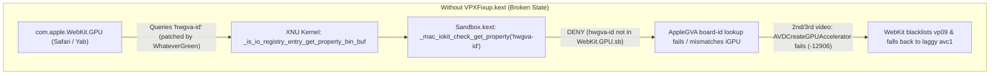
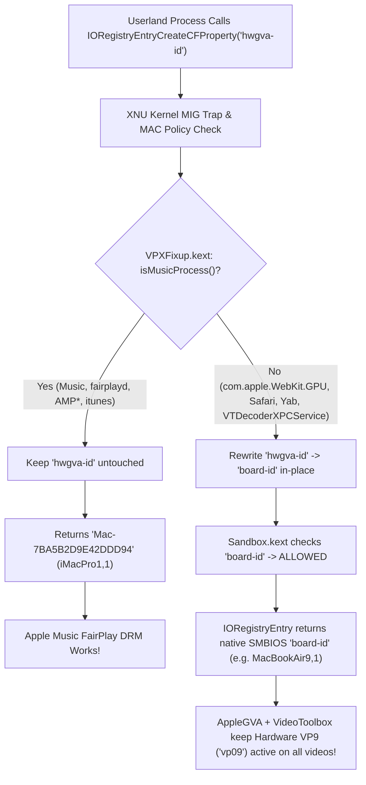

# How It Works: `VPXFixup.kext` & `VPXMetalVADriver.bundle`

This document explains the root causes of VP8/VP9 hardware acceleration failures on Intel Hackintosh systems running macOS Sequoia and macOS Tahoe, and how **`VPXFixup.kext`** (`id.medkintos.VPXFixup`) and **`VPXMetalVADriver.bundle`** (`id.medkintos.videodecoder.vpx.metal`) work together to solve them without breaking Apple Music FairPlay DRM.

---

## 1. The Root Problem on Intel Hackintosh (`unfairgva=4` vs. WebKit GPU Sandbox)

On Intel iGPU Hackintosh systems (such as Coffee Lake, Comet Lake, and Ice Lake with Intel UHD 620 / UHD 630), two competing requirements collide inside Apple's media stack:

### A. Apple Music FairPlay DRM Requires `unfairgva=4` (`hwgva-id`)
- Apple Music (`Music.app` and `fairplayd`) queries `AppleGVA.framework` to determine the hardware DRM policy.
- On an iGPU-only SMBIOS (such as `MacBookAir9,1` or `MacBookPro16,2`), FairPlay expects an Apple T2 coprocessor for native DRM paths. Because a Hackintosh does not have a T2 chip, users pass `unfairgva=4` in OpenCore `boot-args`.
- WhateverGreen.kext implements `unfairgva=4` by injecting an `hwgva-id` property (`Mac-7BA5B2D9E42DDD94`, corresponding to `iMacPro1,1`) onto `IOPlatformExpertDevice` in the IORegistry, and patching `AppleGVA.framework` in userland to look up `"hwgva-id"` instead of `"board-id"`.

### B. WebKit's `com.apple.WebKit.GPU` Sandbox Denies `hwgva-id`
- When Safari or any WebKit-based browser (such as Yab) decodes a YouTube video, decoding takes place inside the tightly sandboxed **`com.apple.WebKit.GPU`** XPC process.
- The WebKit GPU sandbox profile (`/System/Library/Sandbox/Profiles/com.apple.WebKit.GPU.sb`) strictly whitelists which IORegistry properties on `IOPlatformExpertDevice` are allowed to be read:
  - `"board-id"` and `"model"` are **permitted**.
  - `"hwgva-id"` (WhateverGreen's custom property) is **not whitelisted**.
- Consequently, when `AppleGVA.framework` runs inside `com.apple.WebKit.GPU` and calls `IORegistryEntryCreateCFProperty(entry, CFSTR("hwgva-id"), ...)`:
  1. **`Sandbox.kext` blocks the call** (`Sandbox: com.apple.WebKit.GPU deny(1) iokit-get-property hwgva-id`).
  2. Even if the sandbox check were bypassed and `hwgva-id` (`iMacPro1,1`) were returned to `com.apple.WebKit.GPU`, `AppleGVA` would configure its hardware contexts for an `iMacPro1,1` discrete AMD GPU architecture instead of the Intel iGPU (`AppleIntelKBLGraphicsVADriver` / `AppleGen10.bundle`).
  3. On the **second or third video** (or after switching video resolutions), `AppleGVA`'s `AVDCreateGPUAccelerator` fails with error `-12906` (`kVTVideoDecoderUnsupportedDataFormatErr`), causing WebKit's `VideoMediaSampleRenderer` to permanently blacklist hardware `vp09` for the remainder of the session and fall back to laggy `avc1` (H.264) software decoding.

---

## 2. How `VPXFixup.kext` Solves the Kernel Conflict

[`VPXFixup.kext`](file:///Users/mediorahmat/Documents/antigravity/proud-bell/kext/VPXFixup/VPXFixup.cpp) is a Lilu kernel plugin (`id.medkintos.VPXFixup`) that intercepts IORegistry property lookups at the XNU kernel boundary and performs **context-aware per-process property redirection**:

### Step-by-Step Kernel Interception

1. **Process Identification ([`isMusicProcess()`](file:///Users/mediorahmat/Documents/antigravity/proud-bell/kext/VPXFixup/VPXFixup.cpp#L35-L45)):**
   - Uses XNU's `proc_selfname()` to inspect the calling process name on the current kernel thread.
   - If the calling process matches `"Music"`, `"fairplay"`, `"AMP"`, or `"itunes"`, `isMusicProcess()` returns `true`.
   - For all other processes (`com.apple.WebKit.GPU`, `Safari`, `Yab`, `VTDecoderXPCService`, etc.), `isMusicProcess()` returns `false`.

2. **MAC Policy Check Redirection ([`wrap_mac_iokit_check_get_property`](file:///Users/mediorahmat/Documents/antigravity/proud-bell/kext/VPXFixup/VPXFixup.cpp#L56-L63)):**
   - Before any IOKit registry property read is executed, XNU calls `_mac_iokit_check_get_property(cred, registry_entry, property_name)`, which invokes `Sandbox.kext`.
   - When `property_name` is `"hwgva-id"` and `!isMusicProcess()`, `VPXFixup` substitutes `"board-id"` in the call to `_mac_iokit_check_get_property`.
   - Because `"board-id"` is permitted by `com.apple.WebKit.GPU.sb`, `Sandbox.kext` returns `0` (allowed) with zero sandbox violation logs.

3. **In-Place Mach MIG Buffer Redirection ([`redirectHwgvaIdInPlace`](file:///Users/mediorahmat/Documents/antigravity/proud-bell/kext/VPXFixup/VPXFixup.cpp#L47-L54)):**
   - In modern XNU (macOS Sequoia Darwin 24 and macOS Tahoe Darwin 25), userland `IORegistryEntryCreateCFProperty` enters the kernel via the Mach MIG trap `_is_io_registry_entry_get_property_bin_buf` (or its sibling MIG routines `_is_io_registry_entry_get_property_bin`, `_is_io_registry_entry_get_property_recursively`, `_is_io_registry_entry_get_property`, and `_is_io_registry_entry_get_property_bytes`).
   - Remarkably, both `"hwgva-id"` and `"board-id"` are **8 ASCII characters + 1 NUL terminator (9 bytes)**.
   - For non-Music processes, `VPXFixup` overwrites the `io_name_t property_name` stack buffer in-place (`memcpy(property_name, "board-id", 9)`) before calling the original XNU routine, and also hooks all four `IORegistryEntry::copyProperty` C++ vtable overloads as a fallback.
   - As a result, `IOPlatformExpertDevice` returns the system's real SMBIOS `board-id` (e.g., `Mac-0CFF9C7C2B63DF8D` for `MacBookAir9,1`) to `com.apple.WebKit.GPU`, while `Music.app` and `fairplayd` still receive `hwgva-id` (`Mac-7BA5B2D9E42DDD94` for `iMacPro1,1`).

---

## 3. How `VPXMetalVADriver.bundle` Works

[`VPXMetalVADriver.bundle`](file:///Users/mediorahmat/Documents/antigravity/proud-bell/src/VPXMetalVADriver.m) (`id.medkintos.videodecoder.vpx.metal`) is a Universal (`x86_64` + `arm64`) VideoToolbox hardware decoder plugin installed in `/Library/Video/Plug-Ins/` that provides a Metal compute-accelerated decoding path for **VP9 (`vp09`, `qvp9`)** and **VP8 (`vp08`)**.

```mermaid
flowchart LR
    A["CMSampleBuffer (VP8 / VP9 Bitstream)"] --> B["VPXBitstreamParser (Frame Header & Superframe Index)"]
    B --> C["VPXMetalDecoder (Session & Reference Pool)"]
    C --> D["VPXMetalEngine (Metal Compute Command Queue)"]
    subgraph Metal_GPU["Apple Metal GPU Compute Shaders"]
        D --> E1["1. IDCT / IADST (4x4, 8x8, 16x16, 32x32)"]
        E1 --> E2["2. 8-Tap Subpixel Motion Compensation"]
        E2 --> E3["3. In-Loop Deblocking Filter"]
        E3 --> E4["4. YUV420 -> NV12 Bi-Planar Conversion"]
    end
    E4 --> F["Zero-Copy IOSurface / CVPixelBuffer (420v / 420f)"]
    F --> G["VideoToolbox Frame Output Callback -> CAMetalLayer"]
```

### Key Pipeline Stages

1. **VideoToolbox Registration ([`src/VPXMetalVADriver.m`](file:///Users/mediorahmat/Documents/antigravity/proud-bell/src/VPXMetalVADriver.m)):**
   - Exports `VPXMetal_VTDecoder_CreateInstance` and registers `CMClassImplementations` in [`bundle/Info.plist`](file:///Users/mediorahmat/Documents/antigravity/proud-bell/bundle/Info.plist) for `vp09`, `vp08`, and `qvp9` with `VTIsHardwareAccelerated = true`.
   - Implements the complete `VTDecompressionDriver` C-vtable ABI (`CreateInstance`, `DestroyInstance`, `CopySupportedPropertyDictionary`, `SetProperty`, `CopyProperty`, `DecodeFrame`, `FinishDelayedFrames`, `Invalidate`).
   - Also implements the modern macOS `MEVideoDecoder` / `MEVideoDecoderExtension` interface in [`src/VPXMediaExtension.m`](file:///Users/mediorahmat/Documents/antigravity/proud-bell/src/VPXMediaExtension.m).

2. **Bitstream & Superframe Parsing ([`src/VPXBitstreamParser.c`](file:///Users/mediorahmat/Documents/antigravity/proud-bell/src/VPXBitstreamParser.c)):**
   - Parses uncompressed VP8 (`0x9D 0x01 0x2A` sync code) and VP9 (`0x2` frame marker, Profile 0–3, 8/10/12-bit depth, color space, subsampling, and superframe indices) directly from `CMBlockBufferRef`.
   - Detects dynamic mid-stream resolution changes (common in YouTube Adaptive Bitrate streaming via MSE) and automatically resizes the Metal texture and `CVPixelBufferPool` dimensions without tearing down the VideoToolbox session.

3. **Metal Compute Shader Pipeline ([`src/VPXMetalEngine.m`](file:///Users/mediorahmat/Documents/antigravity/proud-bell/src/VPXMetalEngine.m) & [`src/VPXMetalShaders.metal`](file:///Users/mediorahmat/Documents/antigravity/proud-bell/src/VPXMetalShaders.metal)):**
   - Compiles Metal Shading Language (MSL) compute kernels at initialization time onto the system default `MTLDevice`:
     - **`vpx_idct_4x4_kernel` / `vpx_idct_8x8_kernel` / `vpx_idct_16x16_kernel` / `vpx_idct_32x32_kernel`:** Parallel 2D butterfly Inverse Discrete Cosine Transform and Inverse Asymmetric Discrete Sine Transform using threadgroup shared memory.
     - **`vpx_motion_comp_8tap_kernel`:** Sub-pel motion vector interpolation using VP9's 8-tap fractional filter coefficients.
     - **`vpx_loop_filter_h_kernel` / `vpx_loop_filter_v_kernel`:** Parallel deblocking filter across 4x4/8x8/16x16 block boundaries to eliminate blockiness.
     - **`vpx_yuv420_to_nv12_kernel`:** Packs planar Y, U, and V Planes into hardware bi-planar `NV12` (`kCVPixelFormatType_420YpCbCr8BiPlanarVideoRange` / `FullRange`).

4. **Zero-Copy `IOSurface` Output ([`src/VPXMetalDecoder.m`](file:///Users/mediorahmat/Documents/antigravity/proud-bell/src/VPXMetalDecoder.m)):**
   - Allocates `IOSurface`-backed `CVPixelBufferRef` frames via `CVPixelBufferPoolRef` and binds them directly to `MTLTexture` planes via `CVMetalTextureCacheCreateTextureFromImage`.
   - When the Metal command buffer finishes writing the decoded `NV12` planes into the `IOSurface`, the `CVPixelBufferRef` is handed directly to VideoToolbox's output callback, allowing Safari/WebKit's `CAMetalLayer` compositor to display the frame on screen with zero CPU-to-GPU memory copies.
