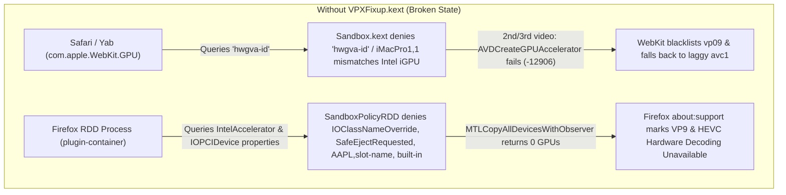
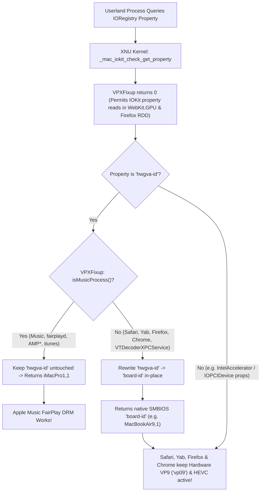

# How It Works: `VPXFixup.kext` (`id.medkintos.VPXFixup`)

This document explains the root causes of VP9 and HEVC hardware acceleration failures across **Safari**, **WebKit browsers (Yab)**, and **Mozilla Firefox** on Intel Hackintosh systems running macOS Sequoia and macOS Tahoe, and how **`VPXFixup.kext`** (`id.medkintos.VPXFixup`) solves them in the kernel without breaking Apple Music FairPlay DRM.

> 🔗 **Companion Metal VideoToolbox Driver Bundle:** For the standalone Metal compute shader VideoToolbox driver bundle (`VPXMetalVADriver.bundle`), see [**medkintos/VP8MetalDecoder**](https://github.com/medkintos/VP8MetalDecoder).

---

## 1. The Root Problems on Intel Hackintosh

On Intel iGPU Hackintosh systems (such as Coffee Lake, Comet Lake, and Ice Lake with Intel UHD 620 / UHD 630), competing requirements collide inside Apple's media and sandbox stack:

### A. Apple Music FairPlay DRM Requires `unfairgva=4` (`hwgva-id`)
- Apple Music (`Music.app` and `fairplayd`) queries `AppleGVA.framework` to determine the hardware DRM policy.
- On an iGPU-only SMBIOS (such as `MacBookAir9,1` or `MacBookPro16,2`), FairPlay expects an Apple T2 coprocessor for native DRM paths. Because a Hackintosh does not have a T2 chip, users pass `unfairgva=4` in OpenCore `boot-args`.
- `WhateverGreen.kext` implements `unfairgva=4` by injecting an `hwgva-id` property (`Mac-7BA5B2D9E42DDD94`, corresponding to `iMacPro1,1`) onto `IOPlatformExpertDevice` in the IORegistry, and patching `AppleGVA.framework` in userland to look up `"hwgva-id"` instead of `"board-id"`.

### B. WebKit's `com.apple.WebKit.GPU` Sandbox Denies `hwgva-id` & Mismatches `iMacPro1,1`
- When Safari or any WebKit-based browser (such as Yab) decodes a YouTube video, decoding takes place inside the tightly sandboxed **`com.apple.WebKit.GPU`** XPC process.
- The WebKit GPU sandbox profile (`/System/Library/Sandbox/Profiles/com.apple.WebKit.GPU.sb`) strictly whitelists which IORegistry properties on `IOPlatformExpertDevice` are allowed to be read:
  - `"board-id"` and `"model"` are **permitted**.
  - `"hwgva-id"` (WhateverGreen's custom property) is **not whitelisted**.
- Consequently, when `AppleGVA.framework` runs inside `com.apple.WebKit.GPU` and calls `IORegistryEntryCreateCFProperty(entry, CFSTR("hwgva-id"), ...)`:
  1. **`Sandbox.kext` blocks the call** (`Sandbox: com.apple.WebKit.GPU deny(1) iokit-get-property hwgva-id`).
  2. Even if the sandbox check were bypassed and `hwgva-id` (`iMacPro1,1`) were returned to `com.apple.WebKit.GPU`, `AppleGVA` would configure its hardware contexts for an `iMacPro1,1` discrete AMD GPU architecture instead of the Intel iGPU (`AppleIntelKBLGraphicsVADriver` / `AppleGen10.bundle`).
  3. On the **second or third video** (or after switching video resolutions), `AppleGVA`'s `AVDCreateGPUAccelerator` fails with error `-12906` (`kVTVideoDecoderUnsupportedDataFormatErr`), causing WebKit's `VideoMediaSampleRenderer` to permanently blacklist hardware `vp09` for the remainder of the session and fall back to laggy `avc1` (H.264) software decoding.

### C. Firefox's `plugin-container` (RDD Process) Sandbox Blocks GPU Enumeration
- Mozilla Firefox initializes its VideoToolbox hardware decoders (`AppleDecoderModule` / `AppleVTDecoder`) inside its **Remote Data Decoder (RDD)** child process (`plugin-container`).
- Firefox applies a custom macOS sandbox policy (`SandboxPolicyRDD`) with `(deny iokit-get-properties (with no-log))` and a hardcoded list of only 16 permitted IOKit properties.
- On macOS Sequoia and Tahoe, `Metal.framework` (`MTLCopyAllDevicesWithObserver` ➔ `MTLDeviceArrayInitialize`) queries four additional IOKit properties during Intel GPU enumeration that Mozilla did not include in `SandboxPolicyRDD`:
  - `IntelAccelerator`: `IOClassNameOverride`, `SafeEjectRequested`, `AAPL,slot-name`
  - `IOPCIDevice`: `built-in`
- When `Sandbox.kext` denies those property reads, `MTLCopyAllDevicesWithObserver()` returns **0 Metal devices** inside Firefox's RDD process, causing `VTDecompressionSessionCreate` to fail with `-12906` and leaving both **VP9** and **HEVC** marked as **Unsupported** in `about:support`.

---

## 2. How `VPXFixup.kext` Solves Both Kernel Conflicts

[`VPXFixup.kext`](file:///Users/mediorahmat/Documents/antigravity/proud-bell/kext/VPXFixup/VPXFixup.cpp) (`id.medkintos.VPXFixup`) intercepts IORegistry property lookups and MAC policy checks at the XNU kernel boundary:

### Step-by-Step Kernel Interception

1. **Process Identification ([`isMusicProcess()`](file:///Users/mediorahmat/Documents/antigravity/proud-bell/kext/VPXFixup/VPXFixup.cpp#L35-L45)):**
   - Uses XNU's `proc_selfname()` to inspect the calling process name on the current kernel thread.
   - If the calling process matches `"Music"`, `"fairplay"`, `"AMP"`, or `"itunes"`, `isMusicProcess()` returns `true`.
   - For all other processes (`com.apple.WebKit.GPU`, `Safari`, `Yab`, `plugin-container`, `Google Chrome Helper`, `VTDecoderXPCService`, etc.), `isMusicProcess()` returns `false`.

2. **MAC Policy Check Allowance ([`wrap_mac_iokit_check_get_property`](file:///Users/mediorahmat/Documents/antigravity/proud-bell/kext/VPXFixup/VPXFixup.cpp#L56-L63)):**
   - Before any IOKit registry property read is executed, XNU calls `_mac_iokit_check_get_property(cred, registry_entry, property_name)`, which invokes `Sandbox.kext`.
   - `VPXFixup` returns `0` (`KERN_SUCCESS`) from `wrap_mac_iokit_check_get_property`, solving **two** browser sandbox issues simultaneously:
     1. **Safari / WebKit (`com.apple.WebKit.GPU`):** Prevents `Sandbox.kext` from denying `"hwgva-id"`.
     2. **Firefox (`plugin-container` RDD Process):** Allows `Metal.framework` and `VideoToolbox` to read `IOClassNameOverride`, `SafeEjectRequested`, `AAPL,slot-name`, and `built-in` so `MTLCopyAllDevicesWithObserver()` discovers the Intel GPU inside Firefox's RDD sandbox, enabling both **VP9** and **HEVC** hardware decoding in Firefox (`about:support`).

3. **In-Place Mach MIG Buffer Redirection ([`redirectHwgvaIdInPlace`](file:///Users/mediorahmat/Documents/antigravity/proud-bell/kext/VPXFixup/VPXFixup.cpp#L47-L54)):**
   - In modern XNU (macOS Sequoia Darwin 24 and macOS Tahoe Darwin 25), userland `IORegistryEntryCreateCFProperty` enters the kernel via the Mach MIG trap `_is_io_registry_entry_get_property_bin_buf` (or its sibling MIG routines `_is_io_registry_entry_get_property_bin`, `_is_io_registry_entry_get_property_recursively`, `_is_io_registry_entry_get_property`, and `_is_io_registry_entry_get_property_bytes`).
   - Both `"hwgva-id"` and `"board-id"` are **8 ASCII characters + 1 NUL terminator (9 bytes)**.
   - For non-Music processes, `VPXFixup` overwrites the `io_name_t property_name` stack buffer in-place (`memcpy(property_name, "board-id", 9)`) before calling the original XNU routine, and also hooks all four `IORegistryEntry::copyProperty` C++ vtable overloads as a fallback.
   - As a result, `IOPlatformExpertDevice` returns the system's real SMBIOS `board-id` (e.g., `Mac-0CFF9C7C2B63DF8D` for `MacBookAir9,1`) to browsers and VideoToolbox processes, while `Music.app` and `fairplayd` still receive `hwgva-id` (`Mac-7BA5B2D9E42DDD94` for `iMacPro1,1`).
